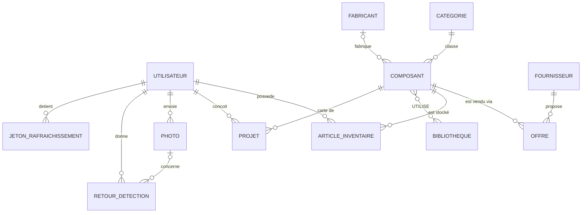

# Modélisation Merise et base de données (C4)

## Choix du SGBD
**PostgreSQL 17 + pgvector** : données fortement relationnelles (composants, offres, inventaires,
projets), accès concurrents des deux API, rôles SQL (lecture seule pour l'accès direct), extension
vectorielle pour le RAG des datasheets. SQLite reste utilisé en développement et en test.

## MCD


## MLD (extrait)
- UTILISATEUR (**id**, username, email_chiffre, email_index, mot_de_passe_hache, ville, role, consentement_entrainement, actif, cree_le, derniere_connexion)
- COMPOSANT (**id**, nom, #categorie_id, #fabricant_id, mpn, description, tension_min, tension_max, interfaces, boitier, datasheet, prix_reference, source)
- OFFRE (**id**, #composant_id, #fournisseur_id, sku, prix_unitaire_eur, prix_origine, devise_origine, stock, url, collecte_le)
- ARTICLE_INVENTAIRE (**id**, #utilisateur_id, #composant_id, quantite, emplacement, note) — unicité (utilisateur, composant, emplacement)
- UTILISE (**#composant_id, #bibliotheque_nom**)

MPD : `microforge/src/microforge/api_data/db.py` (SQLModel), créé sans erreur par `init_db()`.

## Installation reproductible
```bash
cd microforge/infra && docker compose --profile core up -d postgres
uv run mf-pipeline load --clean-dir data/clean     # script d'import documenté
```
