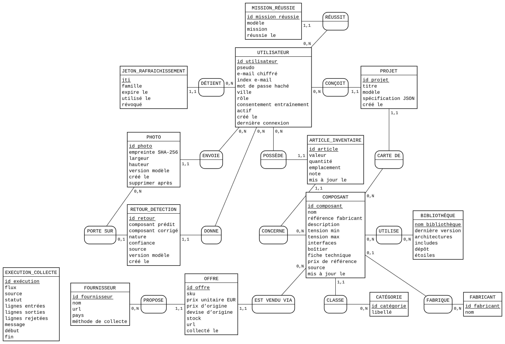
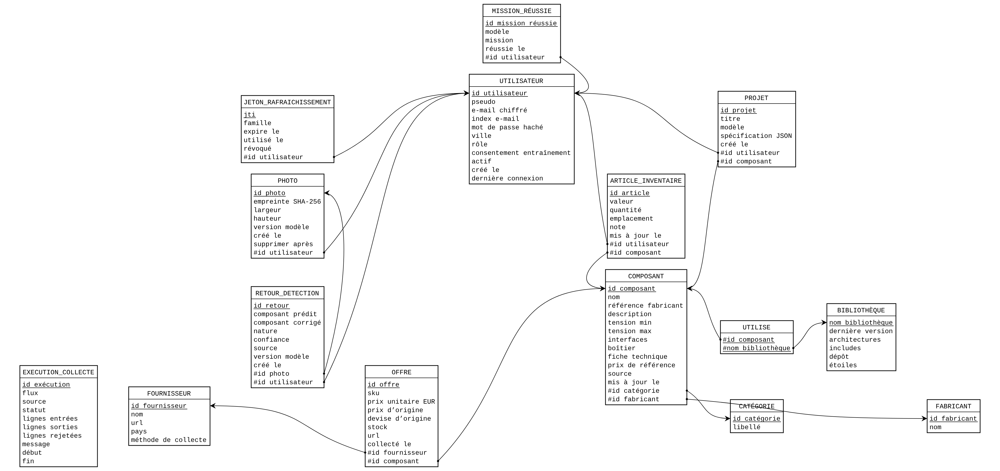

# Modélisation Merise et base de données (C4)

## Choix du SGBD
**PostgreSQL 17 + pgvector** : données fortement relationnelles (composants, offres, inventaires,
projets), accès concurrents des deux API, rôles SQL (lecture seule pour l'accès direct), extension
vectorielle pour le RAG des datasheets. SQLite reste utilisé en développement et en test.

## MCD
Source au format Mocodo : [`merise.mcd`](merise.mcd). 14 entités et 15 associations, dont une
association n,n (UTILISE). Les identifiants de composant prédit et corrigé de RETOUR_DETECTION sont des
attributs, pas des associations : un retour peut citer une classe du détecteur absente du catalogue.



Cardinalités à lire : un UTILISATEUR possède 0,n ARTICLE_INVENTAIRE ; un ARTICLE_INVENTAIRE concerne
1,1 COMPOSANT ; un COMPOSANT est vendu via 0,n OFFRE, chacune proposée par 1,1 FOURNISSEUR ; un
COMPOSANT est fabriqué par 0,1 FABRICANT (fabricant parfois absent des sources) ; un RETOUR_DETECTION
porte sur 0,1 PHOTO (retour possible sans photo conservée, cf. RGPD).

## MLD
Produit par Mocodo à partir du MCD (`-t markdown`) : 15 relations, exactement les 15 tables des
migrations Alembic `0001` (14 tables) et `0005` (missions réussies), plus `0002` pour la valeur des articles, `0003` et `0004` pour les index de recherche. Clé primaire soulignée, clés
étrangères préfixées par `#`.



- **ARTICLE_INVENTAIRE** (<u>id article</u>, valeur, quantité, emplacement, note, mis à jour le, _#id utilisateur_, _#id composant_) — unicité (utilisateur, composant, valeur, emplacement)
- **BIBLIOTHÈQUE** (<u>nom bibliothèque</u>, dernière version, architectures, includes, dépôt, étoiles)
- **CATÉGORIE** (<u>id catégorie</u>, libellé)
- **COMPOSANT** (<u>id composant</u>, nom, référence fabricant, description, tension min, tension max, interfaces, boîtier, fiche technique, prix de référence, source, mis à jour le, _#id catégorie_, _#id fabricant_)
- **EXECUTION_COLLECTE** (<u>id exécution</u>, flux, source, statut, lignes entrées, lignes sorties, lignes rejetées, message, début, fin)
- **FABRICANT** (<u>id fabricant</u>, nom) — nom unique
- **FOURNISSEUR** (<u>id fournisseur</u>, nom, url, pays, méthode de collecte) — nom unique
- **JETON_RAFRAICHISSEMENT** (<u>jti</u>, famille, expire le, utilisé le, révoqué, _#id utilisateur_)
- **MISSION_RÉUSSIE** (<u>id mission réussie</u>, modèle, mission, réussie le, _#id utilisateur_) — unicité (utilisateur, modèle, mission) ; effacée avec le compte
- **OFFRE** (<u>id offre</u>, sku, prix unitaire EUR, prix d'origine, devise d'origine, stock, url, collecté le, _#id fournisseur_, _#id composant_)
- **PHOTO** (<u>id photo</u>, empreinte SHA-256, largeur, hauteur, version modèle, créé le, supprimer après, _#id utilisateur_)
- **PROJET** (<u>id projet</u>, titre, modèle, spécification JSON, créé le, _#id utilisateur_, _#id composant_)
- **RETOUR_DETECTION** (<u>id retour</u>, composant prédit, composant corrigé, nature, confiance, source, version modèle, créé le, _#id photo_, _#id utilisateur_)
- **UTILISATEUR** (<u>id utilisateur</u>, pseudo, e-mail chiffré, index e-mail, mot de passe haché, ville, rôle, consentement entraînement, actif, créé le, dernière connexion) — pseudo et index e-mail uniques
- **UTILISE** (<u>_#id composant_</u>, <u>_#nom bibliothèque_</u>)

## MPD
`microforge/src/microforge/api_data/db.py` (SQLModel) et les migrations Alembic `microforge/migrations/`.
Index : clés étrangères interrogées par l'application (`ix_offre_component_id`, `ix_offre_supplier_id`,
`ix_*_user_id`), liste par catégorie (`ix_composant_category_id_id`, composite, migration `0003`), recherche « contient » (trois index trigrammes `pg_trgm` sur le nom, l'identifiant et la description, PostgreSQL seulement, migration `0004`), recherche par référence (`ix_composant_mpn`), unicités
(pseudo, index e-mail, fabricant). Leur effet est mesuré sur la base réelle par
`mf-pipeline bench-index` (workflow `collecte`, résultats dans `docs/E1/requetes.md`). DDL complet sans
base : `MF_DATABASE_URL=postgresql://u@h/microforge uv run alembic upgrade head --sql`.

Le test `tests/test_merise.py` vérifie que le MCD et le schéma SQLModel restent alignés : mêmes
tables, mêmes clés étrangères.

## Régénérer les diagrammes
```bash
uv venv /tmp/mocodo && uv pip install --python /tmp/mocodo/bin/python mocodo==4.3.3
/tmp/mocodo/bin/mocodo --input microforge/docs/E1/merise.mcd --output_dir /tmp/mcd -t markdown
/tmp/mocodo/bin/mocodo --input microforge/docs/E1/merise.mcd --output_dir /tmp/mcd -t diagram
/tmp/mocodo/bin/mocodo --input /tmp/mcd/merise_mld.mcd --output_dir /tmp/mcd
```
Les SVG produits sont convertis en PNG dans Chromium (Playwright).

## Installation reproductible
```bash
cd microforge/infra && docker compose --profile core up -d postgres
uv run mf-pipeline load --clean-dir data/clean     # script d'import documenté
```
