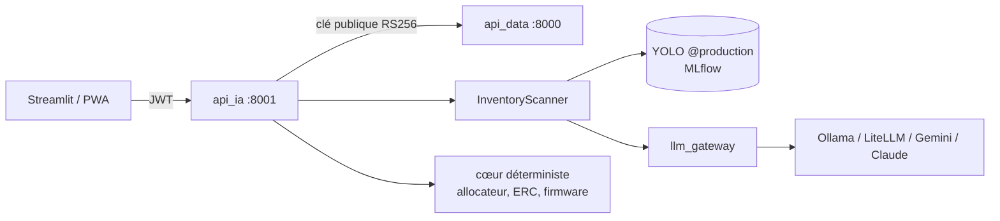

# API exposant le modèle (C9) et intégration (C10)

OpenAPI : http://localhost:8001/docs. Code : `microforge/src/microforge/api_ia/`.

## Architecture

## Points de terminaison
| Méthode | Chemin | Description | Sécurité |
|---|---|---|---|
| GET | `/health`, `/metrics` | supervision | public (réseau interne) |
| GET | `/v1/models/current` | détecteur, chaîne LLM, profil | JWT |
| POST | `/v1/vision/scan` | photo (≤ 8 Mo, JPEG/PNG/WEBP) → composants + quantités | JWT, 30/h par utilisateur |
| POST | `/v1/builds/suggest` | projets réalisables avec un stock | JWT |
| POST | `/v1/builds/generate`, `/v1/builds/bundle` | livrables JSON / zip | JWT |
| POST | `/v1/builds/from-goal`, `/v1/builds/ideas` | « je veux construire… », idées LLM | JWT, 20/h |

Vérifications : format et taille d'image (Pillow, protection « bombe de décompression »), EXIF supprimé,
schémas Pydantic, quotas, jetons vérifiés **avec la seule clé publique** (l'API IA ne peut pas en émettre).

## Intégration (C10)
`app_streamlit/client.py` : authentification, **renouvellement automatique** du jeton sur 401 puis
rejeu de la requête, gestion des erreurs ; écran d'inventaire avec tableau éditable (validation/correction
accessible au clavier) ; envoi des retours pour le monitoring.

## Tests
`microforge/tests/test_api_ia.py` (tous les endpoints : vision VLM seul et YOLO + VLM, refus de fichiers,
suggestions, génération, zip, objectif libre, idées, métriques) et `test_streamlit_client.py`.
