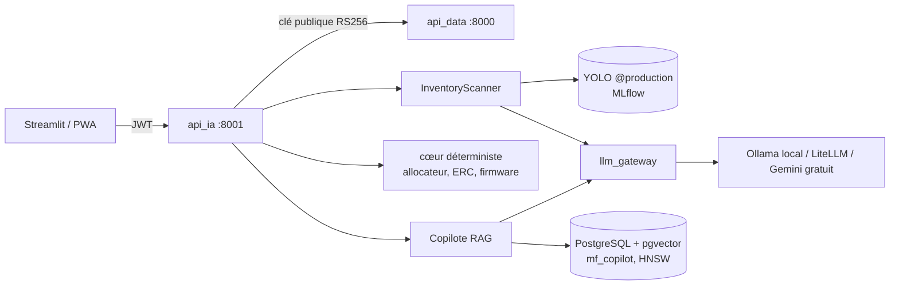

# API exposant le modèle (C9) et intégration (C10)

OpenAPI : http://localhost:8001/docs. Code : `microforge/src/microforge/api_ia/`.

## Architecture

## Points de terminaison
| Méthode | Chemin | Description | Sécurité |
|---|---|---|---|
| GET | `/health`, `/metrics` | supervision | public (réseau interne) |
| GET | `/v1/models/current` | détecteur, chaîne LLM, profil | JWT |
| POST | `/v1/vision/scan` | photo (≤ 8 Mo, JPEG/PNG/WEBP) → composants + quantités | JWT, 30/h par utilisateur |
| POST | `/v1/builds/suggest` | projets réalisables avec un stock | JWT |
| POST | `/v1/builds/generate`, `/v1/builds/bundle` | livrables JSON / zip | JWT |
| POST | `/v1/builds/from-goal`, `/v1/builds/ideas` | « je veux construire… », idées LLM | JWT, 20/h |
| POST | `/v1/copilot/ask` | question libre → réponse citée [n] + sources du catalogue | JWT, 60/h |

## Copilote RAG
Corpus = le catalogue lui-même (`copilot/corpus.py` : 358 passages — composants, 40 cartes, familles,
projets, idées, parcours, vitrine), donc les mêmes règles que le câblage et l'ERC. Index **mémoire** par
défaut, **PostgreSQL + pgvector** si `MF_COPILOT_VECTOR_URL` est défini (Docker Compose le fait) :
colonne `vector(n)`, index HNSW `vector_cosine_ops`, recherche `ORDER BY embedding <=> :q`.

- sous `MF_COPILOT_MIN_SCORE` (0,3) : « je ne sais pas », sans appel au LLM ;
- LLM injoignable : repli extractif (les passages et leurs sources) ;
- passages et stock traités comme des **données** dans l'invite système (injection indirecte) ;
- index reconstruit si l'empreinte du catalogue ou la dimension des embeddings change ;
- la question n'est pas journalisée (seulement le mode et le nombre de sources).

Vérifications : format et taille d'image (Pillow, protection « bombe de décompression »), EXIF supprimé,
schémas Pydantic, quotas, jetons vérifiés **avec la seule clé publique** (l'API IA ne peut pas en émettre).

## Intégration (C10)
`app_streamlit/client.py` : authentification, **renouvellement automatique** du jeton sur 401 puis
rejeu de la requête, gestion des erreurs ; écran d'inventaire avec tableau éditable (validation/correction
accessible au clavier) ; envoi des retours pour le monitoring.

## Tests
`microforge/tests/test_api_ia.py` (tous les endpoints : vision VLM seul et YOLO + VLM, refus de fichiers,
suggestions, génération, zip, objectif libre, idées, métriques), `test_copilot.py` (réponse citée, refus
sous le seuil, repli sans LLM, route protégée ; scénario pgvector dans le job CI dédié) et
`test_streamlit_client.py`.
