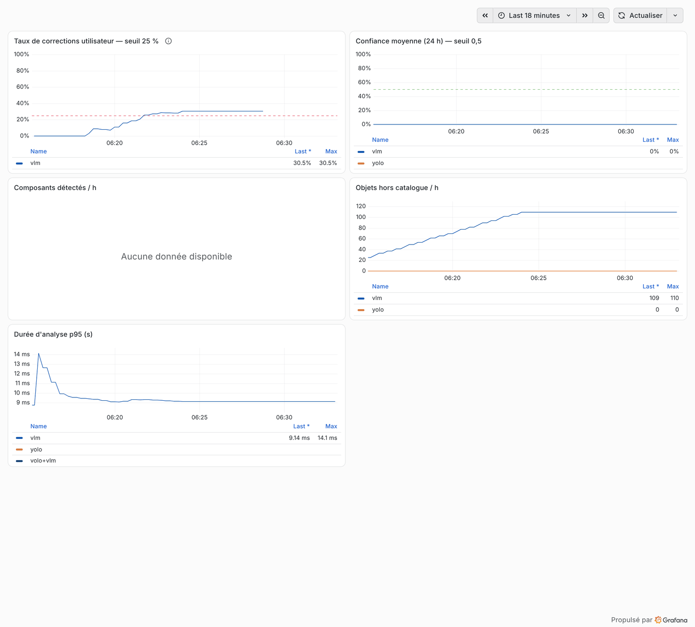

# Monitoring du modèle (C11)

| Métrique | Signification | Collecte | Seuil / déclencheur |
|---|---|---|---|
| `mf_detection_correction_rate{source}` | part des détections corrigées par les utilisateurs (7 j) | table `retour_detection` → `/metrics` d'api_data | > 25 % pendant 1 h → **réentraînement** (`repository_dispatch: retrain`) |
| `mf_detection_confidence` (histogramme) | confiance des prédictions | api_ia | moyenne < 0,5 sur 24 h → enquête dérive |
| `mf_detections_unknown_total` | objets hors catalogue | api_ia | > 20 % sur 6 h → enrichir catalogue/dataset |
| `mf_scan_seconds` | durée d'analyse | api_ia | suivie dans le tableau (p95) ; pas d'alerte dédiée, la latence p95 des API couvre le cas |
| mAP50 sur le split de test | performance mesurée | `evaluate.py`, dans `model-cd.yml` (mensuel ou à la demande) | baisse > 5 points → le modèle n'est pas promu ; sur des retours utilisateurs étiquetés : à faire (pas encore de retours réels) |

**Restitution** : tableau Grafana « MicroForge — Modèle de vision » (titres explicites, seuils écrits dans
les titres, valeurs en légende tabulaire) ; alertes envoyées à Alertmanager, puis Discord si l'adresse
du webhook est fournie.

**Réentraînement** : l'alerte `TauxCorrectionsEleve` porte `action=retrain` ; `model-cd.yml` se lance par
`gh api repos/gprodi/PCO/dispatches -f event_type=retrain` (envoi automatique depuis Alertmanager : à
faire, il faut un relais muni d'un jeton GitHub).

**Tests** : `monitoring/prometheus/alerts.test.yml` (promtool) vérifie chaque alerte sur des séries
synthétiques, au-dessus et en dessous du seuil ; `tests/test_monitoring.py` vérifie que chaque
métrique utilisée existe dans les `/metrics` des API.

**Bac à sable, essai du 06/11/2026** : `traffic_generator.py --drift` (photos sombres, 60 % de
corrections), API en local avec un modèle de langage simulé. Taux de corrections mesuré 60 % ;
`TauxCorrectionsEleve`, `ConfianceMoyenneBasse` et `ObjetsInconnusEnHausse` passent à l'état *pending*,
puis *firing* après leur durée (1 h ou 2 h). L'essai a corrigé trois défauts : histogramme de latence
plafonné à 1 s, compteurs absents avant la première photo (confiance incalculable), part d'objets
inconnus divisée par les seules détections reconnues (alerte muette quand tout est inconnu).

