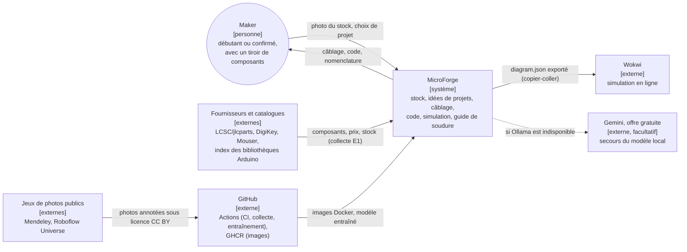
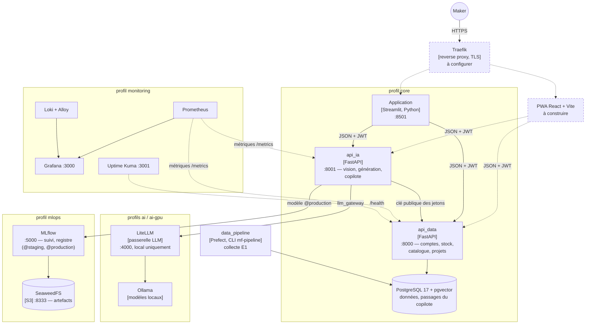
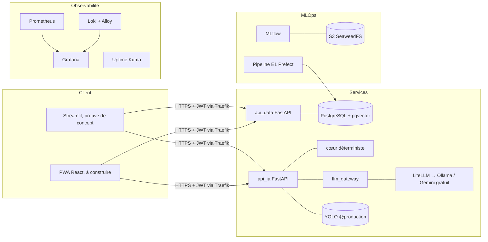
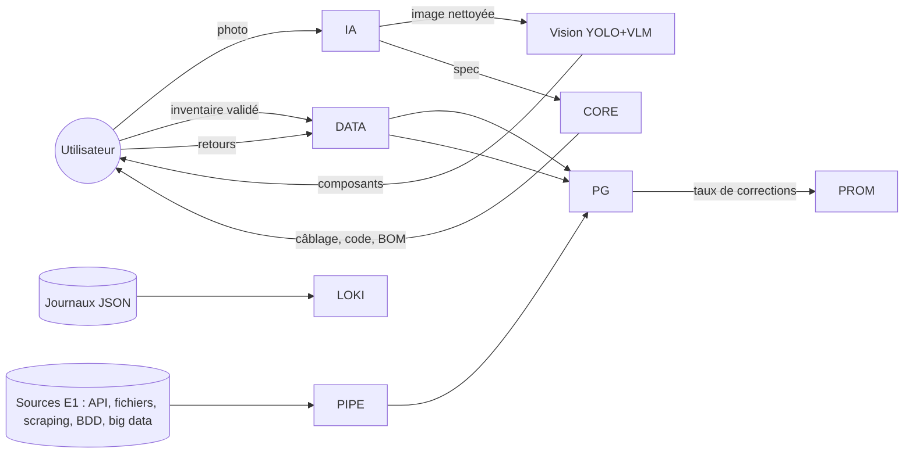

# Cadre technique (C15)

## C4, niveau 1 : contexte
Qui utilise MicroForge et avec quels systèmes il échange. Seuls les échanges réellement codés figurent.

## C4, niveau 2 : conteneurs
Services du fichier `infra/docker-compose.yml`, regroupés par profil de lancement (`--profile`).

Les éléments en pointillés sont la cible, pas encore en place (voir « Cible et état d'avancement »).

Le profil `veille` ajoute FreshRSS (agrégation des flux de veille, E2).

## Vue d'ensemble (micro-services, n-tiers)

## Diagramme de flux de données (critère C15)

## Choix techniques
| Besoin | Choix | Alternatives écartées |
|---|---|---|
| Langage back | Python 3.12 + FastAPI (vu en formation, typage Pydantic, OpenAPI) | Node.js |
| Front | Streamlit (preuve de concept, en place), puis PWA React + Vite (à construire : caméra, hors ligne, WebSerial) | Flutter (2 bases de code) |
| Base | PostgreSQL + pgvector | MongoDB (données relationnelles) |
| IA | Ollama local + LiteLLM (cf. E2) | API cloud seules |
| Hébergement préprod | VPS chez un hébergeur européen éco-engagé (Scaleway / OVHcloud / Infomaniak, comparés dans le benchmark) | hyperscalers US |

## Cible et état d'avancement
| Élément | Cible | État au 04/11/2026 |
|---|---|---|
| Application | Streamlit (preuve de concept) puis PWA React + Vite | Streamlit en place ; PWA à construire |
| Accès | Traefik en reverse proxy, TLS Let's Encrypt, redirection HTTPS | à configurer (profil compose dédié) |
| Préproduction | VPS chez un hébergeur européen, pile `core` + Traefik, images GHCR | à déployer (serveur à choisir) |
| Parcours de bout en bout | test Playwright versionné et lancé par la CI (inscription → stock → idées → génération → chaque onglet) | en place : `tests/test_e2e_parcours.py` + `tests/e2e/parcours.cjs`, job CI `e2e` |
| Démo | page statique en ligne, moteur réel et résultats pré-calculés | en ligne |

Aujourd'hui, la preuve de concept se lance en local avec `docker compose --profile core up`, à partir des
images publiées sur GHCR par `cd.yml`. Le parcours stock → idées → projet → câblage, code, simulation
fonctionne de bout en bout.
