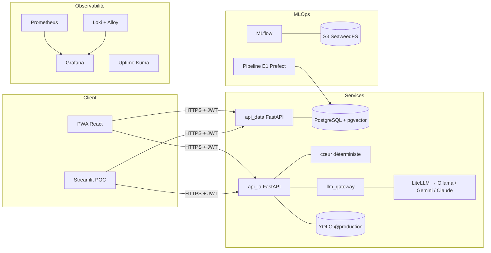
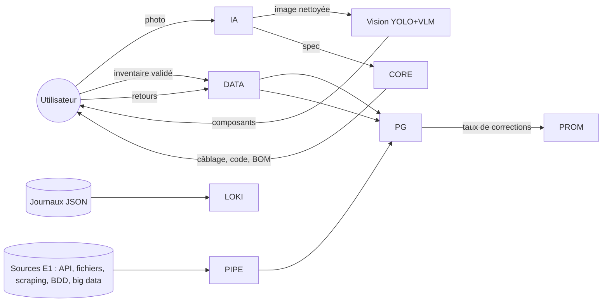

# Cadre technique (C15)

## Architecture (micro-services, n-tiers)

## Diagramme de flux de données (critère C15)

## Choix techniques
| Besoin | Choix | Alternatives écartées |
|---|---|---|
| Langage back | Python 3.12 + FastAPI (vu en formation, typage Pydantic, OpenAPI) | Node.js |
| Front | Streamlit (POC) puis React + Vite PWA (caméra, hors ligne, WebSerial) | Flutter (2 bases de code) |
| Base | PostgreSQL + pgvector | MongoDB (données relationnelles) |
| IA | Ollama local + LiteLLM (cf. E2) | API cloud seules |
| Hébergement préprod | VPS chez un hébergeur européen éco-engagé (Scaleway / OVHcloud / Infomaniak, comparés dans le benchmark) | hyperscalers US |

## Preuve de concept
Accessible en préproduction (compose `core` derrière Traefik + Let's Encrypt). Conclusion **go** :
le parcours photo → projet fonctionne de bout en bout (captures et tests E2E Playwright joints).
