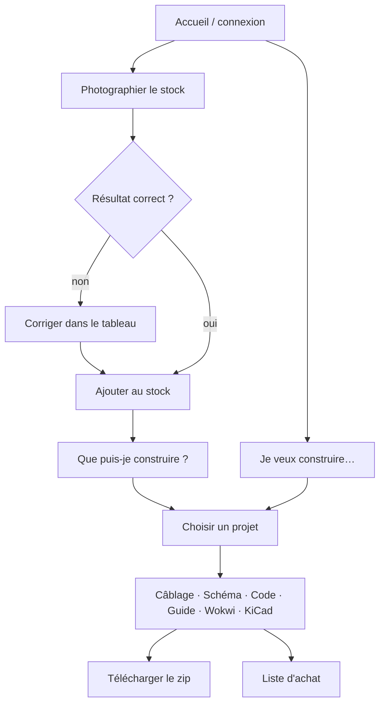

# Modélisation des données et des parcours (C14)

- **Données** : MCD Merise de l'application → voir [E1 Merise](../E1/merise.md) (tables utilisateur, inventaire, projet, photo, retour).
- **Parcours principal** :

Maquettes (Penpot, open-source) : `docs/E4/maquettes/` (exports PNG + lien du fichier Penpot).
