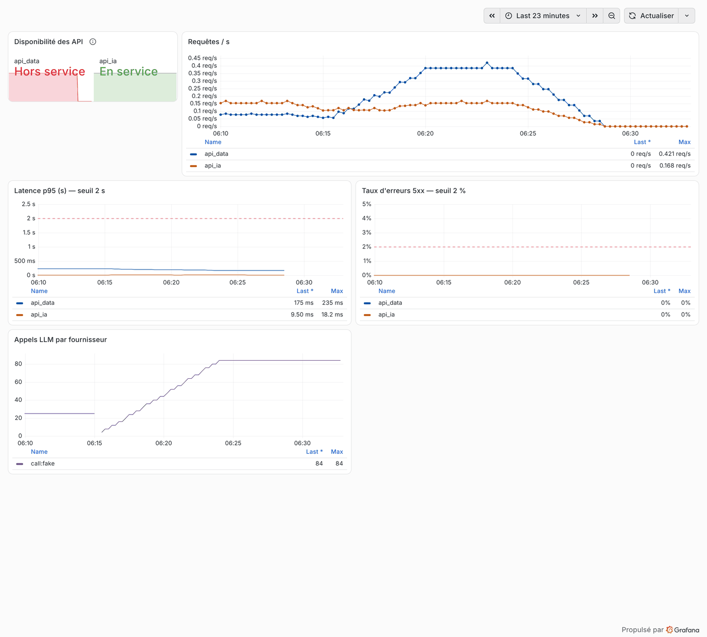
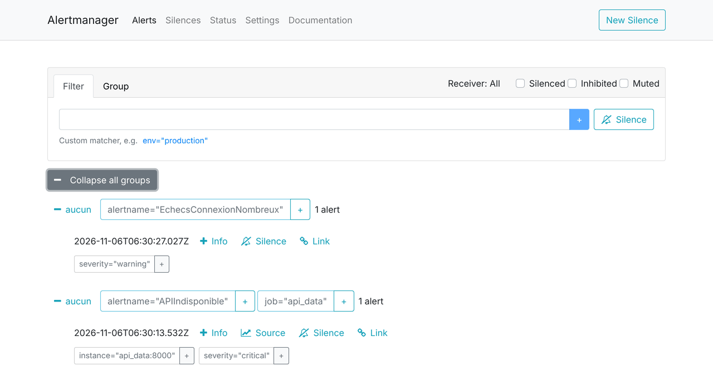

# Monitorage de l'application (C20)

Installation : `docker compose --profile monitoring up -d` (cf. `microforge/monitoring/README.md`,
qui décrit aussi l'essai réel du 06/11/2026 et les défauts qu'il a corrigés).

| Métrique | Seuil d'alerte | Outil | Pourquoi |
|---|---|---|---|
| Disponibilité `/health` | panne > 1 min (critique) | Prometheus `up` ; Uptime Kuma (sondes à configurer) | service rendu |
| Latence p95 | > 2 s pendant 5 min (avertissement) | Prometheus, histogramme `http_request_duration_highr_seconds` | expérience utilisateur |
| Erreurs 5xx | > 2 % pendant 5 min (critique) | Prometheus | bug ou dépendance en panne |
| Replis LLM | > 10 en 15 min | `mf_llm_calls{kind="fallback"}` | Ollama indisponible |
| Échecs de connexion | > 20 par minute | Loki, règle LogQL (`monitoring/loki/rules/`) | attaque par force brute |
| Taux de corrections modèle | > 25 % pendant 1 h | `mf_detection_correction_rate` | qualité du modèle (boucle MLOps) |

**Chaîne d'alerte** : Prometheus et Loki évaluent les règles, Alertmanager regroupe, évite les doublons
(une panne d'API masque ses alertes de latence et d'erreurs) et notifie Discord quand
`DISCORD_WEBHOOK_URL` est fourni ; Grafana affiche les règles et leur état. Mesuré le 06/11/2026 :
API arrêtée → alerte dans Alertmanager en 80 s ; 45 échecs de connexion par minute → 95 s.

**Vérifications automatiques** : `promtool test rules` (chaque alerte sur des séries synthétiques),
`amtool check-config`, démarrage de la pile dans le job CI « Supervision », cohérence métriques ↔
alertes ↔ tableaux dans `tests/test_monitoring.py`.

**Journalisation** : loguru (JSON en production), identifiant de requête propagé (`X-Request-ID`),
**aucune donnée personnelle** (pas d'e-mail ni de jeton dans les logs), conservation 6 mois.

**Choix d'outillage** : Prometheus/Alertmanager/Grafana/Loki/Uptime Kuma (vus en cours, open-source,
auto-hébergés, gratuits) ; Grafana Alloy remplace Promtail (fin de vie 2026).

