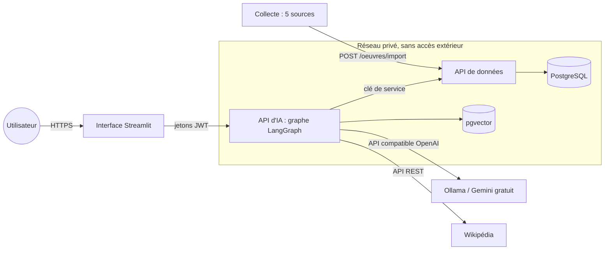
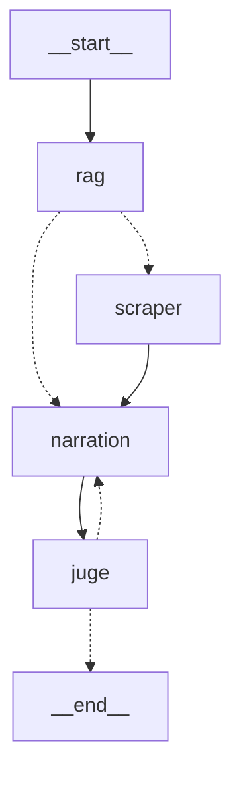

# Architecture

## Conteneurs et réseaux



## Graphe des agents

Chaque nœud reçoit le `State` et renvoie ce qu'il change ; les aiguillages ne renvoient qu'un nom
d'étape. Le schéma ci-dessous est comparé au graphe compilé par un test (`tests/test_docs.py`).



| Nœud | Rôle | Outils |
|---|---|---|
| `rag` (chercheur) | reconnaît l'œuvre, lit sa fiche, cherche les passages | `trouver_oeuvre`, `metadonnees_oeuvre`, `chercher_passages`, `oeuvres_similaires`, `age_oeuvre` |
| `scraper` (enquêteur) | complète le dossier quand la base ne suffit pas | `resume_web` |
| `narration` (narrateur) | rédige à partir du dossier seul (contexte réduit), sources citées | passerelle LLM |
| `juge` | vérifie les citations ; une correction, puis repli extractif | — |

## Modules

```{eval-rst}
.. automodule:: agents.pipeline
   :members:
.. automodule:: agents.router
   :members:
.. automodule:: agents.nodes
   :members:
```
