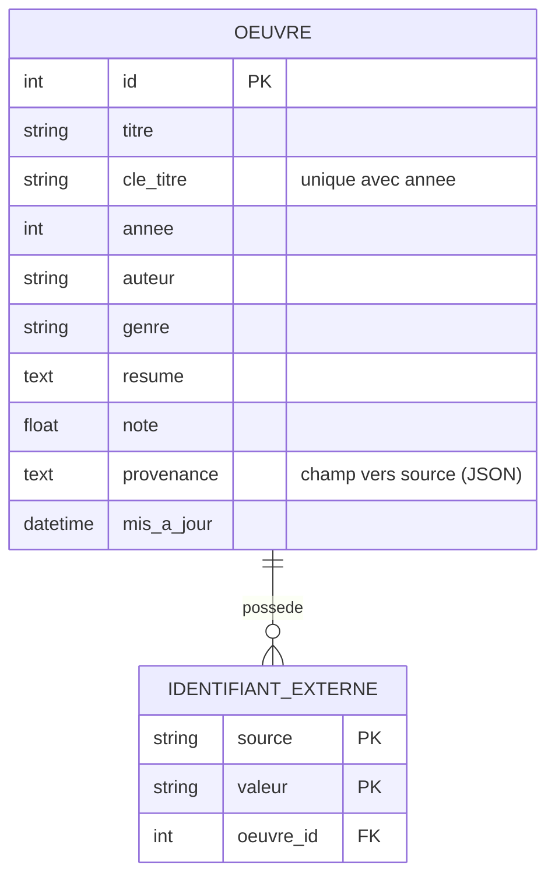

# Données

## Collecte

Cinq types de sources (`collecte/sources.toml`) : API REST, page web (robots.txt respecté), CSV
(Polars), base SQL (requête paramétrée), gros volume (Polars en flux ou Spark). Les dates passent en
ISO 8601, les notes sur 10, les textes sont nettoyés ; la fusion rapproche les œuvres par identifiant
externe puis par titre proche et année, et garde pour chaque champ la source la plus fiable.

## Modèle conceptuel et physique



Aucune donnée personnelle dans cette base. Les comptes de l'interface (adresse et haché Argon2id)
sont dans la base de l'API d'IA, avec droit à l'effacement (`DELETE /auth/moi`).

```{eval-rst}
.. automodule:: donnees.modeles
   :members:
.. automodule:: collecte.fusion
   :members:
```
